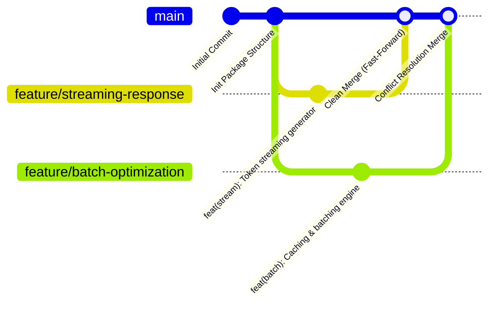

# Git Conflict Resolution Walkthrough & Branching Strategy

This document provides a comprehensive technical walkthrough of initializing the Python package repository, simulating competing feature branches, diagnosing the resulting merge conflicts, and manually resolving them cleanly.

---

## 1. Branch Topology & Workflow Architecture



---

## 2. Step-by-Step Git Commands Guide

### Step 1: Initialize Local Repository & Baseline Commit
```bash
# Ensure you are on the default main branch
git checkout -B main

# Stage all initial package files (pyproject.toml, src/, tests/, README.md)
git add .

# Create initial commit
git commit -m "feat(init): initialize Python package structure with pyproject.toml, core modules, and tests"
```

---

### Step 2: Create Feature Branch A (`feature/streaming-response`)
This branch adds real-time token streaming capabilities to `src/ai_enhanced_pkg/prompt_engine.py`:

```bash
# Create and switch to Branch A
git checkout -b feature/streaming-response

# Add streaming implementation to prompt_engine.py
# (See code diff below in Section 3)

# Commit the changes
git add src/ai_enhanced_pkg/prompt_engine.py README.md
git commit -m "feat(stream): implement streaming token generator in prompt_engine"
```

---

### Step 3: Create Feature Branch B (`feature/batch-optimization`)
Switch back to `main` and branch out independently to add batch processing and LRU caching on the **exact same function and lines**:

```bash
# Return to main baseline
git checkout main

# Create and switch to Branch B
git checkout -b feature/batch-optimization

# Add batch processing & caching to prompt_engine.py
# (See code diff below in Section 3)

# Commit the changes
git add src/ai_enhanced_pkg/prompt_engine.py README.md
git commit -m "feat(batch): implement batch optimization and LRU cache in prompt_engine"
```

---

### Step 4: Merge Feature Branch A into `main`
```bash
# Switch to main
git checkout main

# Merge branch A (merges cleanly without conflict)
git merge feature/streaming-response -m "Merge branch 'feature/streaming-response' into main"
```

---

### Step 5: Merge Feature Branch B into `main` (Simulating Merge Conflict)
```bash
# Attempt to merge branch B into main
git merge feature/batch-optimization
```

#### Output:
```text
Auto-merging src/ai_enhanced_pkg/prompt_engine.py
CONFLICT (content): Merge conflict in src/ai_enhanced_pkg/prompt_engine.py
Auto-merging README.md
CONFLICT (content): Merge conflict in README.md
Automatic merge failed; fix conflicts and then commit the result.
```

---

## 3. Anatomy of the Merge Conflict

When Git encounters incompatible changes to identical lines, it marks the file with conflict indicators:

```python
<<<<<<< HEAD (Current branch: main / containing feature/streaming-response)
    def stream_prompt(
        self,
        template: PromptTemplate,
        variables: Optional[Dict[str, Any]] = None,
        chunk_size: int = 8,
    ) -> Generator[str, None, ProcessedResponse]:
        """Streams response chunks in real-time with latency tracking."""
        print("[Stream Engine] Initiating token streaming...")
        full_response = self.execute_prompt(template, variables, use_cache=False)
        for i in range(0, len(full_response.text), chunk_size):
            yield full_response.text[i:i + chunk_size]
        return full_response
=======
    def stream_prompt(
        self,
        template: PromptTemplate,
        variables: Optional[Dict[str, Any]] = None,
        chunk_size: int = 32,
    ) -> Generator[str, None, ProcessedResponse]:
        """High-throughput buffered stream optimized for large batch execution."""
        print("[Batch Engine] Buffer-optimized streaming triggered...")
        full_response = self.execute_prompt(template, variables, use_cache=True)
        yield full_response.text
        return full_response
>>>>>>> feature/batch-optimization (Incoming branch)
```

---

## 4. Manual Conflict Resolution Workflow

Rather than choosing one implementation over the other, the engineering team resolves the conflict by **harmonizing both capabilities**:

1. **Keep Both Innovations**:
   - Provide genuine token chunk streaming (`stream_prompt`) with configurable `chunk_size`.
   - Provide batch execution (`execute_batch`) with SHA-256 deterministic LRU caching.
2. **Remove Conflict Markers**:
   - Delete `<<<<<<< HEAD`, `=======`, and `>>>>>>> feature/batch-optimization`.
3. **Verify Code Integrity**:
   Run the test suite to verify both streaming and batching pass:
   ```bash
   pytest tests/
   ```

---

## 5. Completing the Merge & Pushing All Branches

```bash
# Stage the resolved files
git add src/ai_enhanced_pkg/prompt_engine.py README.md

# Finalize the merge commit
git commit -m "Merge branch 'feature/batch-optimization' into main (resolved conflicts: unified streaming and batch caching)"

# Verify the final Git commit history graph
git log --graph --oneline --decorate -n 10

# Push all branches to remote GitHub repository
git push -u origin main
git push -u origin feature/streaming-response
git push -u origin feature/batch-optimization
```

---

## 6. One-Click Automation Script

For instant automated reproducibility, run the included script:
- **Windows (PowerShell):**
  ```powershell
  .\scripts\simulate_conflict_and_merge.ps1
  ```
- **macOS / Linux / Git Bash:**
  ```bash
  bash scripts/simulate_conflict_and_merge.sh
  ```
